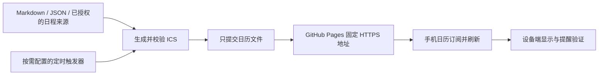

# Calendar Subscription Skill · 日历订阅同步

把“告诉助手一个日程，就能在手机日历里持续看到更新”的实现方式整理为可复用的 Agent Skill。

核心路线：**日程来源 → ICS 文件 → GitHub Pages 固定网址 → 手机日历订阅**。首次订阅完成后，后续更新发布到同一地址，客户端按自己的刷新机制获取变化。



这是一条单向订阅链路。更新源数据后，助手能够重新发布；它不会自行知道课程临时变动，也不会把手机上的编辑写回来源。订阅刷新和提醒送达需要分别验证。

## 从哪里开始

| 文件 | 用途 |
|---|---|
| [SKILL.md](skills/publish-calendar-feed/SKILL.md) | 交给助手执行的入口与判断规则 |
| [实现路线与历史核对](skills/publish-calendar-feed/references/implementation.md) | 当时怎样实现、现有实现的边界、抽取时作了哪些改进 |
| [接入与维护步骤](skills/publish-calendar-feed/references/setup.md) | 数据格式、生成、Pages 发布、手机订阅、改期和故障排查 |
| [持续运行](skills/publish-calendar-feed/references/automation.md) | Windows 与 Codex 触发器、日志和失败处理 |
| [验证记录](docs/validation.md) | 自动检查、行为演练与未验证范围 |

## 使用这个 skill

把完整的 `skills/publish-calendar-feed` 文件夹放进当前环境的技能目录。本机已有的 Codex 技能通常位于 `~/.codex/skills`；以客户端实际使用的位置为准。当前通用文档也支持用户级 `~/.agents/skills`、项目级 `.agents/skills`。不要将同一 skill 同时复制到多个被扫描的目录。[OpenAI 技能编写文档](https://learn.chatgpt.com/docs/build-skills)

也可以把这个 GitHub 仓库地址交给 Codex 的 `skill-installer`，指定目录 `skills/publish-calendar-feed`。安装后用新会话检查是否已发现技能。

示例请求：

> 使用 $publish-calendar-feed，把我的学习安排更新到已有的日历订阅。沿用原地址，并检查改期后是否仍是同一个事件。

## 本地演示

需要 Python 3.10+。生成器只使用 Python 标准库；Windows 发布脚本另需 Git 和 PowerShell。以下命令在本仓库根目录运行：

```powershell
python skills/publish-calendar-feed/scripts/build_feed.py --input skills/publish-calendar-feed/assets/events.example.json --check
python skills/publish-calendar-feed/scripts/build_feed.py --input skills/publish-calendar-feed/assets/events.example.json --output output/study-plan.ics
python -m unittest discover -s tests -v
```

示例是 2030 年的合成课程，不是真实日程。生成本地文件不会发布到 GitHub，也不会改变手机日历。正式接入前按 [接入步骤](skills/publish-calendar-feed/references/setup.md) 配置单独的 feed 仓库。

## 复用范围

- 新增、改期、取消独立的有起止时间事件；可选提前提醒。
- 中文与 UTF-8、明确时区偏移、固定事件身份和显式版本号。
- 内容不变时不重写文件；Windows 发布只暂存目标 ICS，拒绝混入其他工作。
- 既有周期事件、全天事件和双向日历账户写入需要对应实现，不能直接用本例替换。

公开 Pages 会公开日历内容。本仓库只存放技能、脚本和合成示例，不附带个人课表、作业记录、凭证或电脑上的绝对路径。

原始公开 feed 仓库：[wudi-tech/study-calendar](https://github.com/wudi-tech/study-calendar)。此仓库整理其实现模式，不会自动修改或重新启动原来的日历发布任务。
